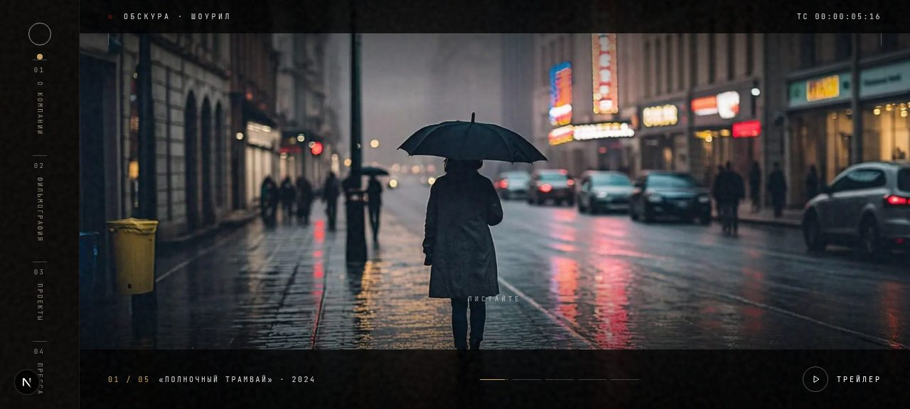
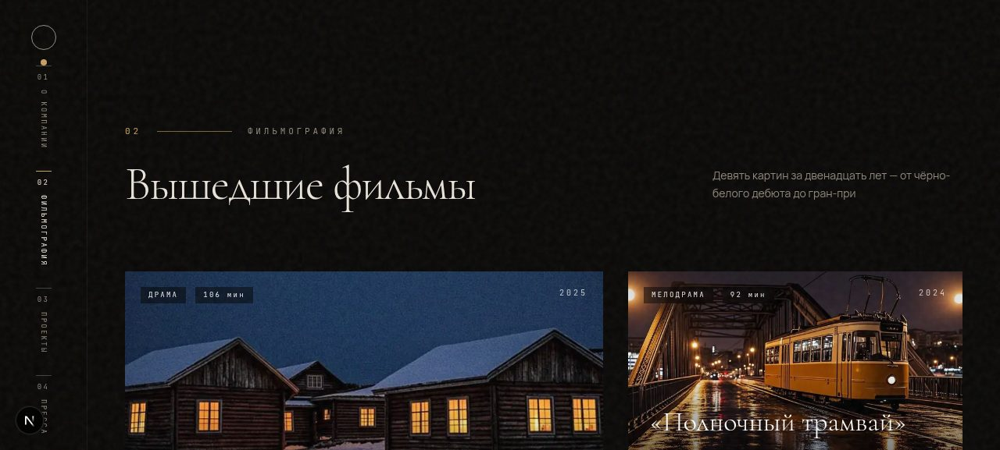

# ОБСКУРА — сайт кинокомпании независимого кино

Минималистичный премиальный сайт вымышленной кинокомпании в эстетике независимого
кино: первый экран — это само кино (кадры и трейлер-шоурил), всё остальное
раскрывается по скроллу и через боковое меню.



## Что внутри

- **Первый экран-кинотеатр** — полноэкранный слайдер кадров с эффектом Ken Burns,
  letterbox-полосами, таймкодом и REC-индикатором; кнопка открывает модальный
  трейлер-шоурил из 7 титров-кадров.
- **Боковое меню** — разделы 01–06 с scroll-spy: активный пункт подсвечивается
  при прокрутке, клик делает плавный переход (Lenis), скроллить руками не обязательно.
- **О компании** — манифест, счётчики с анимацией, карточки продюсеров.
- **Фильмография** — асимметричная сетка из 6 вышедших фильмов с лаврами
  фестивалей и hover-эффектами.
- **Проекты** — 3 фильма в производстве со статусами и прогресс-барами.
- **Пресса** — цитаты СМИ, бегущая строка изданий, пресс-киты.
- **AI-контент** — услуги и процесс производства с параллаксом.
- **Контакты и футер**.



## Технологии

- **Next.js 16** (App Router) + **TypeScript**
- **Tailwind CSS 4** — тёмная тема на CSS-переменных
- **Framer Motion** — reveal-анимации, параллакс, интро-заставка
- **Lenis** — инерционный плавный скролл
- Шрифты: Cormorant Garamond, Manrope, JetBrains Mono (кириллица)
- Плёночное зерно — SVG feTurbulence; уважает `prefers-reduced-motion`

Весь контент (название компании, фильмы, персоны, цитаты) — вымышленный,
изображения сгенерированы нейросетью. Это демонстрационный проект-портфолио.

## Запуск локально

```bash
bun install        # или npm install
bun run dev        # http://localhost:3000
```

## Сборка статики (для GitHub Pages)

```bash
NEXT_EXPORT=1 NEXT_PUBLIC_BASE_PATH=/имя-репозитория bun run build:static
```

Готовый статический сайт появится в папке `.next-export/`.

## Деплой на GitHub Pages

1. Запушьте репозиторий на GitHub (ветка `main`).
2. В **Settings → Pages → Build and deployment → Source** выберите **GitHub Actions**.
3. Workflow `.github/workflows/deploy.yml` соберёт сайт и задеплоит его при
   каждом пуше. Адрес: `https://<username>.github.io/<repository>/`.

Префикс `basePath` подставляется автоматически из имени репозитория —
переименовывать ничего не нужно.

## Тесты

Проект покрыт e2e-тестами Playwright — они проверяют ключевую идею сайта:
первый экран является кино, а все разделы доступны и по скроллу, и через боковое меню.

```bash
bun add -d @playwright/test && bunx playwright install chromium   # один раз
bun run test        # или: npx playwright test
```

7 сценариев: кадр на первом экране виден без скролла; шесть секций идут по порядку
ниже фолда; каждый из 6 пунктов бокового меню приводит ровно в свою секцию;
scroll-spy подсвечивает активный раздел; шоурил-трейлер открывается и закрывается
по Esc; в фильмографии 6 постеров; на мобильной ширине бургер открывает оверлей-меню.

## Структура

```
src/
├── app/                  # страница, layout, глобальные стили
├── components/site/      # Hero, SideMenu, ShowreelModal, секции разделов
├── lib/
│   ├── content.ts        # весь контент сайта (фильмы, продюсеры, пресса)
│   ├── asset.ts          # учёт basePath для картинок (GitHub Pages)
│   └── SmoothScroll.tsx  # синглтон Lenis + программные скроллы
└── public/v2/            # сгенерированные кадры (35mm-эстетика)
```
